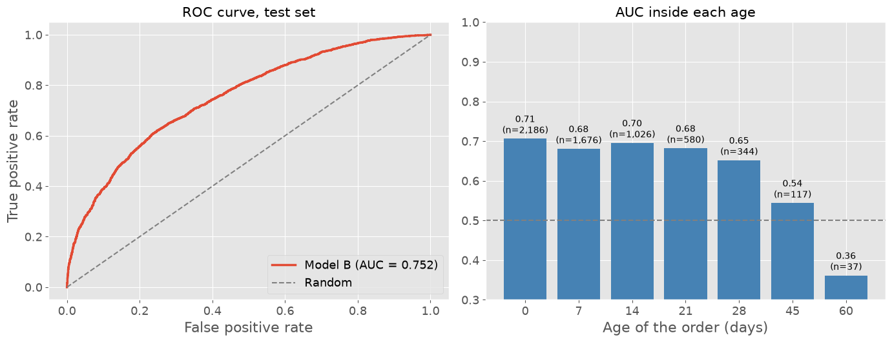

::: {.content-visible when-profile="en"}
::: {.h1 .page-title}
Sales Loss Prediction: ranking open orders with XGBoost, without leakage
:::
:::
::: {.content-visible when-profile="pt"}
::: {.h1 .page-title}
Previsão de perda de vendas: priorizando pedidos em aberto com XGBoost, sem vazamento de dados
:::
:::

*Hugo Batista da Silva*

:::: {.content-visible when-profile="en"}
::: {.callout-note}
**Language:** Python (pandas, XGBoost, SHAP, scikit-learn) · **Type:** work project, rebuilt with synthetic data · **Code:** [github.com/batistugo/sales-loss-prediction](https://github.com/batistugo/sales-loss-prediction)
:::

## About the project
At a distributor of solar energy equipment, the customers are **solar installers** that buy photovoltaic kits. Every quote becomes a sales order that is either won or lost, and the sales team has hundreds of open orders at the same time. The question was: **which open orders are most likely to be lost, and why?**

I built the model and put it into production: a daily job scores the open orders, a weekly job retrains the model, and an API delivers to the sales system a ranking with a priority level and the three main reasons of risk of each order.

The company data cannot be published, so for this portfolio the whole project was rebuilt with **synthetic data** that keeps the structure of the original database. A nice side effect is that we know the **real probability** of loss of each order, which allows comparing the model with the best result theoretically possible.
::::
:::: {.content-visible when-profile="pt"}
::: {.callout-note}
**Linguagem:** Python (pandas, XGBoost, SHAP, scikit-learn) · **Tipo:** projeto profissional, reconstruído com dados sintéticos · **Código:** [github.com/batistugo/sales-loss-prediction](https://github.com/batistugo/sales-loss-prediction)
:::

## Sobre o projeto
Em uma distribuidora de equipamentos de energia solar, os clientes são **integradores** que compram kits fotovoltaicos. Cada orçamento vira um pedido de venda, que pode ser ganho ou perdido, e a equipe comercial tem centenas de pedidos em aberto ao mesmo tempo. A pergunta era: **quais pedidos em aberto têm mais chance de serem perdidos, e por quê?**

Desenvolvi o modelo e o coloquei em produção: uma rotina diária pontua os pedidos em aberto, uma rotina semanal retreina o modelo e uma API entrega ao sistema comercial um ranking com o nível de prioridade e os três principais motivos de risco de cada pedido.

Os dados da empresa não podem ser publicados; por isso, para este portfólio, o projeto inteiro foi reconstruído com **dados sintéticos** que preservam a estrutura da base original. Um efeito colateral interessante é que conhecemos a **probabilidade real** de perda de cada pedido, o que permite comparar o modelo com o melhor resultado teoricamente possível.
::::

::: {.content-visible when-profile="en"}
## The main finding: a leakage hidden in the best variable
The most important variable of the original model compared the time of the order with the customer's usual time. The problem: in training, this time was the number of days **until the outcome**; in production, it was the number of days **until today**. Same name, two different things.

Since lost orders take much longer to close than won ones (24 days against 12 on average), the model learned from information that only exists after the outcome. The fix was to train with **snapshots**: each closed order is "photographed" at several ages (0, 7, 14, 21, 28, 45 and 60 days) while it was still open, exactly like an open order is seen in production.

| Model | Evaluation | AUC |
|-------|------------|-----|
| Original approach | its own validation | 0.762 |
| Original approach | **real conditions of use** | **0.693** |
| Snapshot approach (final) | **real conditions of use** | **0.752** |
| Real probability (theoretical ceiling) | at order creation | 0.758 |

The original validation was promising an AUC of 0.76 that the model could not deliver. The snapshot model reaches that level honestly.

## Other lessons about validation
- **Point-in-time history.** The customer features (usual ticket, discount, kit size, price, loss rate) use only the orders that were **already closed** on the creation date. Cumulative sums ordered by creation date, the classic approach, silently use outcomes from the future.
- **The order stage is a photo of the outcome.** Adding it as a feature gives **AUC = 1.0**; a perfect model is the clearest symptom of leakage.
- **The test set never chooses the model.** Early stopping uses a separate validation window.
- **Recent data is censored.** Orders created in the last 60 days are kept out of the evaluation, because only the fast ones (mostly wins) had time to close.
- **New customers are not thrown away.** XGBoost handles missing values, so the 15% of orders without any past purchase stay in the training instead of being removed by a `dropna()`.

## Evaluation

The model is well calibrated (in the decile where it predicts 86% on average, 89% of the orders were lost), and at the moment of creation it captures about **80% of the discrimination that is possible** above a random guess, compared with the real probability used to generate the data.

## Explanation with SHAP

The age of the order, the customer's historical loss rate, a rejected discount and a price above the market of the state are the main drivers of risk. One result looks strange at first: **financing appears reducing the risk**, although financed orders are lost more. It is an interaction with the age: financed orders that are won take longer to close because of the bank analysis, so a financed order still open after two weeks is normal, while a cash order in the same situation is probably abandoned. A good reminder that a variable should never be interpreted in isolation.

## Notebooks
The full analysis, with all the code, is in four notebooks in the [repository](https://github.com/batistugo/sales-loss-prediction):

1. [Synthetic data](https://github.com/batistugo/sales-loss-prediction/blob/main/notebooks/01_synthetic_data.ipynb)
2. [Exploratory analysis](https://github.com/batistugo/sales-loss-prediction/blob/main/notebooks/02_exploratory_analysis.ipynb)
3. [Features](https://github.com/batistugo/sales-loss-prediction/blob/main/notebooks/03_features.ipynb)
4. [Model](https://github.com/batistugo/sales-loss-prediction/blob/main/notebooks/04_model.ipynb)
:::
::: {.content-visible when-profile="pt"}
## O principal achado: um vazamento de dados escondido na melhor variável
A variável mais importante do modelo original comparava o tempo do pedido com o tempo habitual do cliente. O problema: no treino, esse tempo era o número de dias **até o desfecho**; em produção, era o número de dias **até hoje**. Mesmo nome, duas coisas diferentes.

Como os pedidos perdidos demoram muito mais para fechar do que os ganhos (24 dias contra 12, em média), o modelo aprendeu com uma informação que só existe depois do desfecho, um caso clássico de vazamento de dados (data leakage). A correção foi treinar com **snapshots**: cada pedido fechado é "fotografado" em várias idades (0, 7, 14, 21, 28, 45 e 60 dias) enquanto ainda estava em aberto, exatamente como um pedido em aberto é visto em produção.

| Modelo | Avaliação | AUC |
|-------|------------|-----|
| Abordagem original | validação própria | 0,762 |
| Abordagem original | **condições reais de uso** | **0,693** |
| Abordagem com snapshots (final) | **condições reais de uso** | **0,752** |
| Probabilidade real (teto teórico) | na criação do pedido | 0,758 |

A validação original prometia uma AUC de 0,76 que o modelo não conseguia entregar. O modelo com snapshots chega a esse patamar de forma honesta.

## Outras lições sobre validação
- **Histórico no tempo certo (point-in-time).** As variáveis do cliente (ticket habitual, desconto, tamanho do kit, preço, taxa de perda) usam apenas os pedidos que já estavam **fechados** na data de criação. Somas acumuladas ordenadas pela data de criação, a abordagem clássica, usam silenciosamente desfechos do futuro.
- **A etapa do pedido é uma foto do desfecho.** Incluí-la como variável dá **AUC = 1,0**; um modelo perfeito é o sintoma mais claro de vazamento de dados.
- **O conjunto de teste nunca escolhe o modelo.** A parada antecipada (early stopping) usa uma janela de validação temporal separada.
- **Os dados recentes têm censura à direita.** Os pedidos criados nos últimos 60 dias ficam fora da avaliação, porque só os rápidos (em sua maioria, ganhos) tiveram tempo de fechar.
- **Clientes novos não são descartados.** O XGBoost lida com valores ausentes, então os 15% de pedidos sem nenhuma compra anterior permanecem no treino, em vez de serem eliminados por um `dropna()`.

## Avaliação

O modelo tem boa calibração (no decil em que prevê 86% em média, 89% dos pedidos foram perdidos) e, no momento da criação, captura cerca de **80% da discriminação possível** acima de um chute aleatório, em comparação com a probabilidade real usada para gerar os dados.

## Explicação com SHAP

A idade do pedido, a taxa de perda histórica do cliente, um desconto recusado e um preço acima do mercado do estado são os principais fatores de risco. Um resultado parece estranho à primeira vista: **o financiamento aparece reduzindo o risco**, embora pedidos financiados sejam mais perdidos. Trata-se de uma interação com a idade: os pedidos financiados que são ganhos demoram mais para fechar por causa da análise do banco; assim, um pedido financiado ainda em aberto após duas semanas é normal, enquanto um pedido à vista na mesma situação provavelmente foi abandonado. Um bom lembrete de que uma variável nunca deve ser interpretada isoladamente.

## Notebooks
A análise completa, com todo o código, está em quatro notebooks no [repositório](https://github.com/batistugo/sales-loss-prediction):

1. [Dados sintéticos](https://github.com/batistugo/sales-loss-prediction/blob/main/notebooks/01_synthetic_data.ipynb)
2. [Análise exploratória](https://github.com/batistugo/sales-loss-prediction/blob/main/notebooks/02_exploratory_analysis.ipynb)
3. [Variáveis](https://github.com/batistugo/sales-loss-prediction/blob/main/notebooks/03_features.ipynb)
4. [Modelo](https://github.com/batistugo/sales-loss-prediction/blob/main/notebooks/04_model.ipynb)
:::
