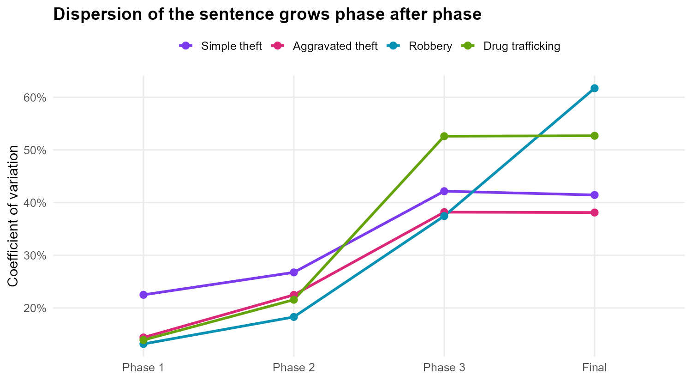
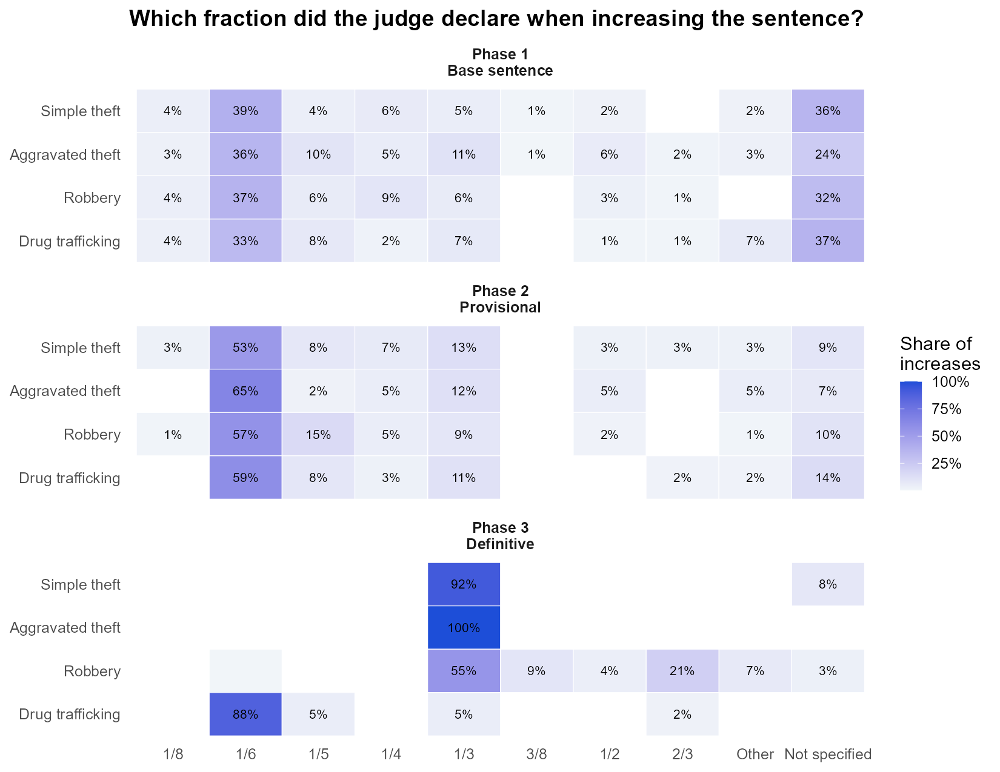
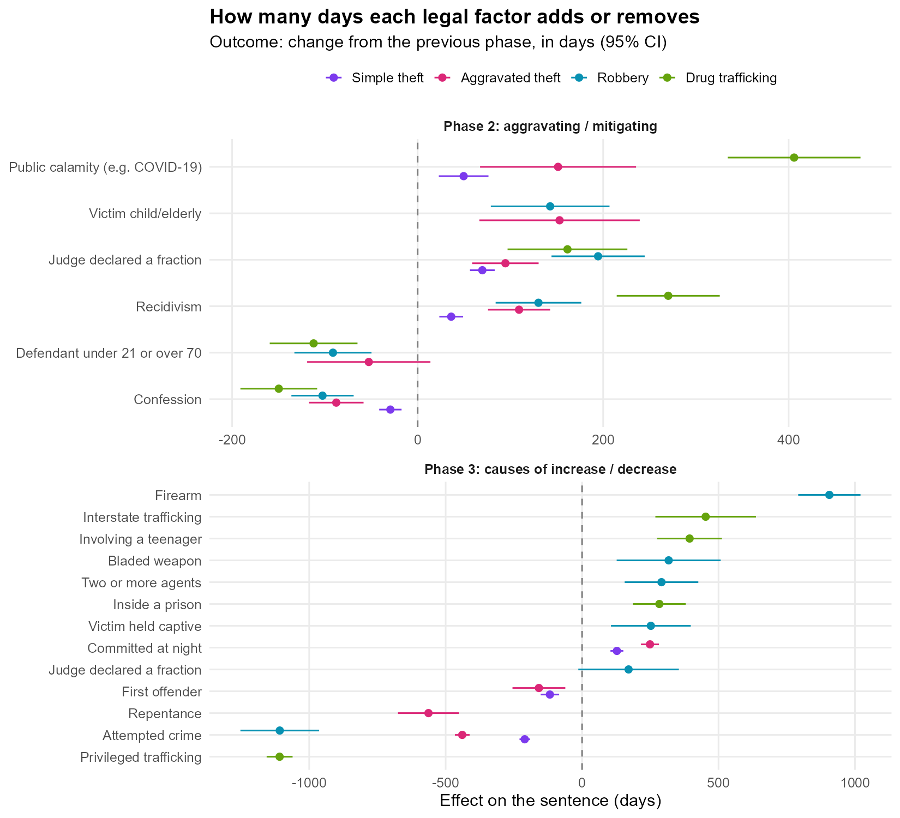

::: {.content-visible when-profile="en"}
::: {.h1 .page-title}
Judicial Sentencing in Numbers: the statistical methodology of a PhD thesis
:::
:::
::: {.content-visible when-profile="pt"}
::: {.h1 .page-title}
Dosimetria da pena em números: a metodologia estatística de uma tese de doutorado
:::
:::

*Hugo Batista da Silva*

:::: {.content-visible when-profile="en"}
::: {.callout-note}
**Language:** R (data.table, MASS, car, lmtest, caret, cluster) · **Type:** statistical consulting for a PhD in Law · **Data:** public on OSF ([gender study](https://osf.io/vr4zf), [confession study](https://osf.io/23ytq)) · **Outputs:** 1 thesis and 3 peer-reviewed articles
:::

## About the project
How do Brazilian judges actually calculate a criminal sentence? The Brazilian Penal Code defines a **three-phase method** (*dosimetria trifásica*), but leaves a lot of room for discretion: the law says *which* factors increase or decrease the sentence, and often not *by how much*.

Gabriel Silveira de Queirós Campos, a PhD candidate in Law, wanted to measure this discretion empirically in the São Paulo State Court (TJ-SP). I was responsible for the **whole statistical methodology**: turning court decisions into data, the sampling plan, the analysis strategy and the answers to the examining committee. The methodology received the **maximum grade** from the committee, and the same database produced three articles in which I am a co-author.

This page focuses on what I consider the most important part of the work: **the planning decisions**, and why each one was taken.

## 1. From a legal method to a dataset
The first problem was not statistical: a sentence is a long legal text, and there was no dataset. The solution was to design a **coding instrument that mirrors the three phases of the legal method**, so that each decision is transcribed exactly in the order in which the judge reasons.

```{mermaid}
flowchart LR
  A["Phase 1<br/>Base sentence<br/><small>art. 59: culpability, record,<br/>circumstances, consequences</small>"] --> B["Phase 2<br/>Provisional sentence<br/><small>aggravating and<br/>mitigating factors</small>"]
  B --> C["Phase 3<br/>Definitive sentence<br/><small>causes of increase<br/>and decrease</small>"]
  C --> D["Final sentence<br/><small>multiple crimes,<br/>continued crime</small>"]
```

The pipeline of the research:

```{mermaid}
flowchart LR
  S["Convictions of 2022<br/>counted by crime"] --> N["Sample size<br/>finite population"] --> F["Random selection and<br/>manual coding by phase"] --> L["Cleaning,<br/>16 bases"] --> M["Tests, models<br/>and robustness"]
```

Each legal factor became a binary variable (present or not in the decision), the fraction declared by the judge was recorded as text, and the sentence of each phase was converted to **days**, so that the four crimes could be analysed on the same scale. One base was built for each **crime × phase**, sixteen in total.

## 2. Sampling plan
Four crimes were studied: simple theft, aggravated theft, robbery and drug trafficking. For each one, the number of convictions in 2022 was counted and the minimum sample was calculated with the formula for a **finite population**, with 95% confidence, a 5% margin of error and maximum variance ($p = 0.5$):

$$n = \frac{N \, z^2 \, p(1-p)}{e^2 (N-1) + z^2 \, p(1-p)}$$

| Crime | Convictions (N) | Minimum sample | Collected | Final sample |
|-------|----------------:|---------------:|----------:|-------------:|
| Simple theft | 487 | 216 | 266 | 216 |
| Aggravated theft | 695 | 248 | 288 | 248 |
| Robbery | 1,695 | 314 | 330 | 314 |
| Drug trafficking | 26,919 | 379 | 377 | 373 |
| **Total** | | **1,157** | **1,261** | **1,151** |

Two details of this plan are worth mentioning:

- **The coders collected a margin above the minimum.** This protects the sample against the losses that always appear in manual coding: duplicated decisions, decisions that are not convictions, inconsistencies between phases. All 1,261 decisions were used in the gender article.
- **After cleaning, the thesis used exactly the minimum size.** Duplicated cases were removed and the sample was reduced to the calculated $n$ with a **random subsample with a fixed seed**, so that the final sample remains a simple random sample and anyone can reproduce it. In drug trafficking, the collection stayed slightly below the minimum (377 against 379) and four more decisions were lost to inconsistencies in the case number. With the final 373 decisions the margin of error is 5.04% instead of 5%, a difference that is documented in the thesis.

## 3. The analysis strategy: one model per phase
The most important methodological decision was the definition of the **response variable**. Modelling the final sentence directly would mix the effects of all phases: a confession (phase 2) and a firearm (phase 3) would compete in the same equation, while legally they act at different moments, over different bases.

So each phase got its own model, and in phases 2 and 3 the outcome is the **change in the sentence in relation to the previous phase**:

$$\Delta_{\text{phase } k} = \text{sentence}_{k} - \text{sentence}_{k-1}$$

In practice, in R:
::::
:::: {.content-visible when-profile="pt"}
::: {.callout-note}
**Linguagem:** R (data.table, MASS, car, lmtest, caret, cluster) · **Tipo:** consultoria estatística para um doutorado em Direito · **Dados:** públicos no OSF ([estudo sobre gênero](https://osf.io/vr4zf), [estudo sobre confissão](https://osf.io/23ytq)) · **Resultados:** 1 tese e 3 artigos revisados por pares
:::

## Sobre o projeto
Como os juízes brasileiros calculam, na prática, uma pena criminal? O Código Penal define um **método em três fases** (a *dosimetria trifásica*), mas deixa bastante espaço para a discricionariedade: a lei diz *quais* fatores aumentam ou diminuem a pena e, muitas vezes, não diz *em quanto*.

Gabriel Silveira de Queirós Campos, doutorando em Direito, queria medir empiricamente essa discricionariedade no Tribunal de Justiça de São Paulo (TJ-SP). Fui responsável por **toda a metodologia estatística**: transformar decisões judiciais em dados, o plano amostral, a estratégia de análise e as respostas à banca examinadora. A metodologia recebeu **nota máxima** da banca, e a mesma base de dados deu origem a três artigos dos quais sou coautor.

Esta página se concentra no que considero a parte mais importante do trabalho: **as decisões de planejamento**, e o porquê de cada uma delas.

## 1. Do método jurídico à base de dados
O primeiro problema não era estatístico: uma sentença é um texto jurídico longo, e não existia base de dados. A solução foi desenhar um **instrumento de coleta que espelha as três fases da dosimetria**, de modo que cada decisão fosse transcrita exatamente na ordem em que o juiz raciocina.

```{mermaid}
flowchart LR
  A["Fase 1<br/>Pena-base<br/><small>art. 59: culpabilidade, antecedentes,<br/>circunstâncias, consequências</small>"] --> B["Fase 2<br/>Pena provisória<br/><small>agravantes e<br/>atenuantes</small>"]
  B --> C["Fase 3<br/>Pena definitiva<br/><small>causas de aumento<br/>e de diminuição</small>"]
  C --> D["Pena final<br/><small>concurso de crimes,<br/>crime continuado</small>"]
```

O fluxo da pesquisa:

```{mermaid}
flowchart LR
  S["Condenações de 2022<br/>contadas por crime"] --> N["Tamanho da amostra<br/>população finita"] --> F["Sorteio aleatório e<br/>codificação manual por fase"] --> L["Limpeza,<br/>16 bases"] --> M["Testes, modelos<br/>e robustez"]
```

Cada fator jurídico virou uma variável binária (presente ou não na decisão), a fração declarada pelo juiz foi registrada como texto e a pena de cada fase foi convertida em **dias**, para que os quatro crimes pudessem ser analisados na mesma escala. Foi construída uma base para cada **crime × fase**, dezesseis no total.

## 2. Plano amostral
Foram estudados quatro crimes: furto simples, furto qualificado, roubo e tráfico de drogas. Para cada um, contou-se o número de condenações em 2022 e calculou-se a amostra mínima pela fórmula para **população finita**, com 95% de confiança, margem de erro de 5% e variância máxima ($p = 0.5$):

$$n = \frac{N \, z^2 \, p(1-p)}{e^2 (N-1) + z^2 \, p(1-p)}$$

| Crime | Condenações (N) | Amostra mínima | Coletadas | Amostra final |
|-------|----------------:|---------------:|----------:|-------------:|
| Furto simples | 487 | 216 | 266 | 216 |
| Furto qualificado | 695 | 248 | 288 | 248 |
| Roubo | 1.695 | 314 | 330 | 314 |
| Tráfico de drogas | 26.919 | 379 | 377 | 373 |
| **Total** | | **1.157** | **1.261** | **1.151** |

Dois detalhes desse plano merecem destaque:

- **Os codificadores coletaram uma margem acima do mínimo.** Isso protege a amostra contra as perdas que sempre aparecem na codificação manual: decisões duplicadas, decisões que não são condenações, inconsistências entre as fases. Todas as 1.261 decisões foram usadas no artigo sobre gênero.
- **Após a limpeza, a tese usou exatamente o tamanho mínimo.** Os casos duplicados foram removidos e a amostra foi reduzida ao $n$ calculado por meio de uma **subamostra aleatória com semente fixa**, de modo que a amostra final continua sendo uma amostra aleatória simples e qualquer pessoa pode reproduzi-la. No tráfico de drogas, a coleta ficou ligeiramente abaixo do mínimo (377 contra 379) e mais quatro decisões foram perdidas por inconsistências no número do processo. Com as 373 decisões finais, a margem de erro é de 5,04% em vez de 5%, diferença documentada na tese.

## 3. A estratégia de análise: um modelo por fase
A decisão metodológica mais importante foi a definição da **variável resposta**. Modelar diretamente a pena final misturaria os efeitos de todas as fases: uma confissão (fase 2) e o emprego de arma de fogo (fase 3) competiriam na mesma equação, enquanto, juridicamente, atuam em momentos diferentes e sobre bases diferentes.

Por isso, cada fase ganhou seu próprio modelo e, nas fases 2 e 3, o desfecho é a **variação da pena em relação à fase anterior**:

$$\Delta_{\text{fase } k} = \text{pena}_{k} - \text{pena}_{k-1}$$

Na prática, em R:
::::

```r
furtos2 <- merge(furtos2, furtos1, by = "processo")
furtos2[, dif_pena := penaemdias - penaemdias_1]

fit <- lm(formula = dif_pena ~ reincidencia + incendio + confissao + usou_frac,
          data = furtos2)
```

::: {.content-visible when-profile="en"}
With this, each coefficient has a direct legal reading: **how many days this factor adds or removes in this phase**, given everything that happened before. This produced 12 models (4 crimes × 3 phases), with variables chosen by stepwise AIC among the legally possible ones, 95% confidence intervals and VIF for multicollinearity. The adjusted R² goes from 0.38 to 0.86.

## 4. Decisions guided by evidence
A good methodology is also made of the paths that were **not** taken, and of the reasons for that.

- **Non-parametric tests.** The sentences are far from normal (Kolmogorov-Smirnov, Lilliefors, Anderson-Darling and Shapiro-Wilk all rejected normality), so the comparisons between groups, for example sentences of male and female judges, were made with Wilcoxon / Mann-Whitney tests.
- **Clustering was tested and rejected.** To look for "profiles" of sentencing, five algorithms were tried: k-means, PAM with Gower distance, Ward's hierarchical clustering, DBSCAN and k-prototypes. All of them separated the decisions only by the size of the sentence, which says nothing new. Instead of forcing a result, this was documented and replaced by a **theory-driven grouping**: the most frequent final sentences were traced back through the combination of factors in each phase.
- **No automatic correction for multiple tests.** The study is observational and exploratory, with many related tests. Corrections like Bonferroni would strongly increase the type II error, so the interpretation is based on effect sizes, confidence intervals and legal plausibility (Perneger, 1998; Gelman & Loken, 2014). This choice was argued in writing to the committee.
- **Multilevel models by court district were left for future work.** They are a relevant refinement, but the sample was designed to estimate proportions and effects by crime, not variance between districts.

## 5. Robustness, at the committee's request
For the gender article, the examining committee asked for a deeper validation of the models. The audit included:

| Check | Purpose |
|-------|---------|
| VIF | Multicollinearity between legal factors |
| Breusch-Pagan | Homoscedasticity of the residuals |
| Shapiro-Wilk on standardised residuals + residual plots | Normality of the errors |
| 70/30 train / test split | Stability of the coefficients out of sample |
| 10-fold cross-validation | Predictive stability |
| Leave-one-variable-out sensitivity | How much each variable contributes to the adjusted R² |

## 6. What the data showed

### The dispersion grows phase after phase
If all judges applied the method in the same way, cases with the same characteristics would receive similar sentences. The coefficient of variation of the sentence shows that discretion **accumulates** along the phases: in drug trafficking it goes from 14% in the base sentence to 53% after phase 3.



### Phase 3 is the one that changes the sentence the most

| Crime | Phase 2: average change | Phase 2: cases changed | Phase 3: average change | Phase 3: cases changed |
|-------|------:|------:|------:|------:|
| Simple theft | 38 days | 41% | 65 days | 34% |
| Aggravated theft | 84 days | 47% | 167 days | 44% |
| Robbery | 149 days | 47% | **834 days** | **89%** |
| Drug trafficking | 180 days | 42% | 487 days | 49% |

### Judges strongly prefer some fractions
Where the law does not fix the fraction, **1/6 dominates**: it is the most declared fraction in phases 1 and 2 for all crimes. In phase 3, where the law gives a range, judges stay at the bottom of it: 1/6 for the increases of the drug law (range 1/6 to 2/3) and 1/3 for robbery (range 1/3 to 1/2); for theft at night the law fixes 1/3. An important share of the decisions in phase 1 **does not declare any fraction at all**, which makes the reasoning harder to review.



### How many days each factor is worth



Some results: a confession removes between 29 and 150 days in phase 2, depending on the crime; a firearm adds about 900 days to a robbery; an attempted crime or "privileged" trafficking remove more than 1,000 days. In drug trafficking, a crime committed during a public calamity, in practice the COVID-19 pandemic, added about 400 days.

### Is a confession really worth it?
This question became one of the articles. Brazilian case law (Súmula 231 of the STJ) forbids a mitigating factor from taking the sentence below the legal minimum, so a defendant who confesses but already has a base sentence at the minimum gains nothing. Among the defendants who confessed and had **no aggravating factor**, the share whose sentence did not change in phase 2 was:

| Crime | Cases | Confession had no effect | Average reduction when it had |
|-------|------:|------:|------:|
| Simple theft | 32 | 66% | 82 days |
| Aggravated theft | 36 | 36% | 137 days |
| Robbery | 37 | 57% | 269 days |
| Drug trafficking | 59 | 59% | 318 days |

## Publications
The three articles below were written from this same database and sample. I am a co-author of all of them, and they are listed on my [ORCID profile](https://orcid.org/0009-0005-4875-5394).

1. Campos, G. S. Q.; Bedê, A.; Bussinguer, E. C. A.; **Silva, H. B.** (2025). *Uncovering judges' gender effects in Brazilian sentencing: A counter-hegemonic role of women in the criminal justice system?* **International Journal of Law, Crime and Justice**, 83. [doi:10.1016/j.ijlcj.2025.100789](https://doi.org/10.1016/j.ijlcj.2025.100789)
2. Campos, G.; Bedê Jr., A.; Bussinguer, E. C. A.; **Silva, H. B.** (2026). *Gênero e sentença criminal* (Gender and sentencing). **Revista de Estudos Empíricos em Direito**, 13. [doi:10.19092/reed.v13.995](https://doi.org/10.19092/reed.v13.995)
3. Campos, G.; Bedê Jr., A.; **Silva, H. B.** (2026). *A confissão realmente vale a pena?* (Is a guilty plea really worth it?). **Revista de Estudos Empíricos em Direito**, 13. [doi:10.19092/reed.v13.1081](https://doi.org/10.19092/reed.v13.1081)

## Reproducibility
The data and the R scripts are public on OSF ([gender study](https://osf.io/vr4zf), [confession study](https://osf.io/23ytq)). The figures and tables of this page were generated by [this script](https://github.com/batistugo/MyDataPortfolio/blob/main/analysis/dosimetria_figuras.R), which runs the original model script unchanged and exports only aggregated results.
:::
::: {.content-visible when-profile="pt"}
Com isso, cada coeficiente tem uma leitura jurídica direta: **quantos dias esse fator acrescenta ou retira nesta fase**, dado tudo o que aconteceu antes. Isso gerou 12 modelos (4 crimes × 3 fases), com variáveis selecionadas por stepwise via AIC entre as juridicamente possíveis, intervalos de confiança de 95% e VIF para multicolinearidade. O R² ajustado vai de 0,38 a 0,86.

## 4. Decisões guiadas pela evidência
Uma boa metodologia também é feita dos caminhos que **não** foram seguidos, e das razões para isso.

- **Testes não paramétricos.** As penas estão longe da normalidade (Kolmogorov-Smirnov, Lilliefors, Anderson-Darling e Shapiro-Wilk rejeitaram a normalidade), então as comparações entre grupos, por exemplo entre as penas aplicadas por juízes e por juízas, foram feitas com testes de Wilcoxon / Mann-Whitney.
- **O agrupamento (clusterização) foi testado e descartado.** Em busca de "perfis" de dosimetria, foram testados cinco algoritmos: k-means, PAM com distância de Gower, agrupamento hierárquico de Ward, DBSCAN e k-prototypes. Todos separaram as decisões apenas pelo tamanho da pena, o que não traz nada de novo. Em vez de forçar um resultado, isso foi documentado e substituído por um **agrupamento orientado pela teoria**: as penas finais mais frequentes foram rastreadas de volta pela combinação de fatores em cada fase.
- **Sem correção automática para comparações múltiplas.** O estudo é observacional e exploratório, com muitos testes relacionados entre si. Correções como a de Bonferroni aumentariam fortemente o erro tipo II; por isso, a interpretação se apoia no tamanho dos efeitos, nos intervalos de confiança e na plausibilidade jurídica (Perneger, 1998; Gelman & Loken, 2014). Essa escolha foi justificada por escrito à banca.
- **Modelos multinível por comarca ficaram para trabalhos futuros.** São um refinamento relevante, mas a amostra foi planejada para estimar proporções e efeitos por crime, e não a variância entre comarcas.

## 5. Robustez, a pedido da banca
Para o artigo sobre gênero, a banca examinadora pediu uma validação mais aprofundada dos modelos. A auditoria incluiu:

| Verificação | Objetivo |
|-------|---------|
| VIF | Multicolinearidade entre os fatores jurídicos |
| Breusch-Pagan | Homocedasticidade dos resíduos |
| Shapiro-Wilk nos resíduos padronizados + gráficos de resíduos | Normalidade dos erros |
| Divisão treino / teste 70/30 | Estabilidade dos coeficientes fora da amostra |
| Validação cruzada com 10 folds | Estabilidade preditiva |
| Sensibilidade retirando uma variável por vez | Quanto cada variável contribui para o R² ajustado |

## 6. O que os dados mostraram

### A dispersão cresce fase após fase
Se todos os juízes aplicassem o método da mesma forma, casos com as mesmas características receberiam penas semelhantes. O coeficiente de variação da pena mostra que a discricionariedade se **acumula** ao longo das fases: no tráfico de drogas, ele vai de 14% na pena-base a 53% após a fase 3.


### A fase 3 é a que mais altera a pena

| Crime | Fase 2: variação média | Fase 2: casos alterados | Fase 3: variação média | Fase 3: casos alterados |
|-------|------:|------:|------:|------:|
| Furto simples | 38 dias | 41% | 65 dias | 34% |
| Furto qualificado | 84 dias | 47% | 167 dias | 44% |
| Roubo | 149 dias | 47% | **834 dias** | **89%** |
| Tráfico de drogas | 180 dias | 42% | 487 dias | 49% |

### Os juízes têm forte preferência por algumas frações
Onde a lei não fixa a fração, **1/6 predomina**: é a fração mais declarada nas fases 1 e 2 para todos os crimes. Na fase 3, em que a lei estabelece um intervalo, os juízes ficam no seu limite inferior: 1/6 para as causas de aumento da Lei de Drogas (intervalo de 1/6 a 2/3) e 1/3 para o roubo (intervalo de 1/3 a 1/2); para o furto durante o repouso noturno, a lei fixa 1/3. Uma parcela importante das decisões na fase 1 **não declara fração alguma**, o que dificulta o controle da fundamentação.


### Quantos dias vale cada fator


Alguns resultados: a confissão espontânea retira entre 29 e 150 dias na fase 2, dependendo do crime; o emprego de arma de fogo acrescenta cerca de 900 dias ao roubo; a tentativa e o tráfico privilegiado retiram mais de 1.000 dias. No tráfico de drogas, o crime cometido em situação de calamidade pública, na prática a pandemia de COVID-19, acrescentou cerca de 400 dias.

### A confissão realmente vale a pena?
Essa pergunta virou um dos artigos. A jurisprudência (Súmula 231 do STJ) impede que uma atenuante leve a pena abaixo do mínimo legal; assim, o réu que confessa, mas já tem a pena-base fixada no mínimo, não ganha nada. Entre os réus que confessaram e **não tinham nenhuma agravante**, a proporção cuja pena não se alterou na fase 2 foi:

| Crime | Casos | Confissão sem efeito | Redução média quando houve efeito |
|-------|------:|------:|------:|
| Furto simples | 32 | 66% | 82 dias |
| Furto qualificado | 36 | 36% | 137 dias |
| Roubo | 37 | 57% | 269 dias |
| Tráfico de drogas | 59 | 59% | 318 dias |

## Publicações
Os três artigos abaixo foram escritos a partir desta mesma base de dados e amostra. Sou coautor de todos eles, e eles estão listados no meu [perfil no ORCID](https://orcid.org/0009-0005-4875-5394).

1. Campos, G. S. Q.; Bedê, A.; Bussinguer, E. C. A.; **Silva, H. B.** (2025). *Uncovering judges' gender effects in Brazilian sentencing: A counter-hegemonic role of women in the criminal justice system?* **International Journal of Law, Crime and Justice**, 83. [doi:10.1016/j.ijlcj.2025.100789](https://doi.org/10.1016/j.ijlcj.2025.100789)
2. Campos, G.; Bedê Jr., A.; Bussinguer, E. C. A.; **Silva, H. B.** (2026). *Gênero e sentença criminal*. **Revista de Estudos Empíricos em Direito**, 13. [doi:10.19092/reed.v13.995](https://doi.org/10.19092/reed.v13.995)
3. Campos, G.; Bedê Jr., A.; **Silva, H. B.** (2026). *A confissão realmente vale a pena?* **Revista de Estudos Empíricos em Direito**, 13. [doi:10.19092/reed.v13.1081](https://doi.org/10.19092/reed.v13.1081)

## Reprodutibilidade
Os dados e os scripts em R são públicos no OSF ([estudo sobre gênero](https://osf.io/vr4zf), [estudo sobre confissão](https://osf.io/23ytq)). As figuras e tabelas desta página foram geradas por [este script](https://github.com/batistugo/MyDataPortfolio/blob/main/analysis/dosimetria_figuras.R), que executa o script original dos modelos sem alterações e exporta apenas resultados agregados.
:::
