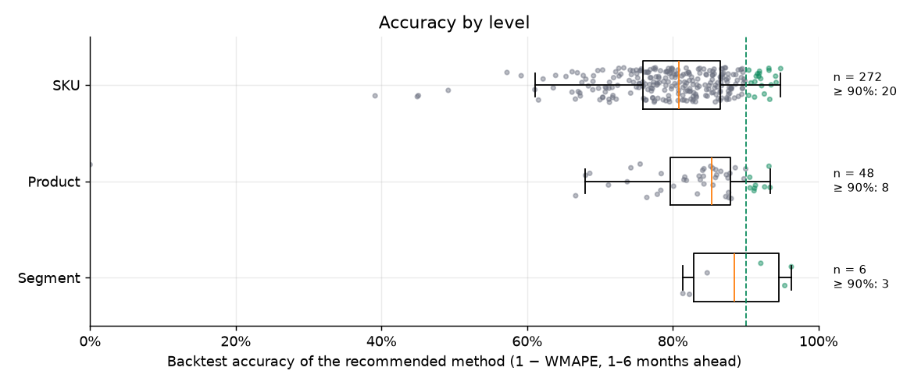

::: {.content-visible when-profile="en"}
::: {.h1 .page-title}
S&OP demand forecasting: a hierarchical ARIMA/ETS pipeline, from the Total to the SKU
:::
:::
::: {.content-visible when-profile="pt"}
::: {.h1 .page-title}
Projeção de demanda para S&OP: pipeline hierárquico ARIMA/ETS, do Total ao SKU
:::
:::

*Hugo Batista da Silva*

:::: {.content-visible when-profile="en"}
::: {.callout-note}
**Language:** Python (statsforecast, pandas, joblib) and Plotly · **Type:** work project, rebuilt with synthetic data · **Code:** [github.com/batistugo/sop-demand-forecasting](https://github.com/batistugo/sop-demand-forecasting)
:::

## About the project
In S&OP (Sales and Operations Planning), the company agrees every month on how much it expects to sell, so that purchasing, production and stock follow the same number. At a textile company, I built and run the **statistical pipeline** that produces the starting point of this process: every month it forecasts the next **28 months** of every item of the catalog, with 80% and 95% prediction intervals. The business areas (sales, purchasing, production…) then adjust this baseline, item by item, in an S&OP web app.

The company data cannot be published, so for this portfolio the whole pipeline was rebuilt with **synthetic data** that keeps the structure of the original (columns, hierarchy and business rules), with **fictitious names** and stronger seasonality than the real series, to make the behaviour of each method easy to see.

## Scale and granularities
The same engine forecasts the four levels of the product hierarchy. A SKU is a fabric in one colour, so the lowest level has thousands of small, noisy and sometimes intermittent series.

| Level | Series in production | Series in the synthetic data | What is forecast |
|-------|---------------------:|-----------------------------:|------------------|
| Total | 1 | 1 | all sales |
| Segment | 12 | 6 | fabric family (linen, viscose, knit…) |
| Product ("parent") | about 490 | 48 | one fabric |
| SKU ("child") | about 3,600 | 300 | fabric × colour |

The synthetic data covers January 2022 to September 2026 (57 months and 70,219 order lines), and the forecast starts in October 2026.

## Interactive dashboard
The dashboard below replicates the forecast screens of the S&OP front end (in production, a React + Plotly app fed by an API), now fed by the outputs of the pipeline on the synthetic data. It opens on the most accurate SKU of the backtest. You can:

- choose the **level** and filter **segment → product → SKU**;
- compare the **⭐ production curve** (with 80% and 95% intervals) with the raw **Combined**, **ARIMA/ETS** and **Top-Down** curves;
- read the actual sales of the last 6/12/18 months against the forecast of the next 6/12/18;
- see the **backtest accuracy of each method**, and in the *Accuracy* tab, the ranking of all series of a level.

::: {.column-page-left}
<iframe class="sop-dash" src="dashboards/sop/index.html?lang=en&aba=proj&nivel=filho&item=VISCOSE%20FALESIA%20-%2003" title="S&OP forecast dashboard" loading="lazy"></iframe>
:::
::::

:::: {.content-visible when-profile="pt"}
::: {.callout-note}
**Linguagem:** Python (statsforecast, pandas, joblib) e Plotly · **Tipo:** projeto profissional, reconstruído com dados sintéticos · **Código:** [github.com/batistugo/sop-demand-forecasting](https://github.com/batistugo/sop-demand-forecasting)
:::

## Sobre o projeto
No S&OP (Sales and Operations Planning, ou planejamento de vendas e operações), a empresa combina todo mês quanto espera vender, para que compras, produção e estoque sigam o mesmo número. Numa empresa têxtil, desenvolvi e mantenho o **pipeline estatístico** que produz o ponto de partida desse processo: todo mês ele projeta os próximos **28 meses** de cada item do catálogo, com intervalos de previsão de 80% e 95%. Depois, as áreas de negócio (comercial, compras, produção…) ajustam essa linha de base, item a item, numa aplicação web de S&OP.

Os dados da empresa não podem ser publicados; por isso, para este portfólio, o pipeline inteiro foi reconstruído com **dados sintéticos** que preservam a estrutura da base original (colunas, hierarquia e regras de negócio), com **nomes fictícios** e sazonalidade mais forte que a das séries reais, para facilitar a visualização do comportamento de cada método.

## Escala e granularidades
O mesmo motor projeta os quatro níveis da hierarquia de produtos. Um SKU é um tecido numa cor; por isso, o nível mais baixo tem milhares de séries pequenas, ruidosas e às vezes intermitentes.

| Nível | Séries em produção | Séries nos dados sintéticos | O que é projetado |
|-------|-------------------:|----------------------------:|-------------------|
| Total | 1 | 1 | todas as vendas |
| Segmento | 12 | 6 | família de tecido (linho, viscose, malha…) |
| Produto ("pai") | cerca de 490 | 48 | um tecido |
| SKU ("filho") | cerca de 3.600 | 300 | tecido × cor |

Os dados sintéticos vão de janeiro de 2022 a setembro de 2026 (57 meses e 70.219 itens de pedido), e a projeção começa em outubro de 2026.

## Dashboard interativo
O dashboard abaixo reproduz as telas de projeção do front do S&OP (em produção, uma aplicação React + Plotly alimentada por uma API), agora alimentado pelas saídas do pipeline sobre os dados sintéticos. Ele abre no SKU com maior acurácia no backteste. É possível:

- escolher o **nível** e filtrar **segmento → produto → SKU**;
- comparar a **curva de produção ⭐** (com intervalos de 80% e 95%) com as curvas cruas **Combinado**, **ARIMA/ETS** e **Top-Down**;
- ler a venda realizada dos últimos 6/12/18 meses contra a projeção dos próximos 6/12/18;
- ver a **acurácia de cada método no backteste** e, na aba *Acurácia*, o ranking de todas as séries de um nível.

::: {.column-page-left}
<iframe class="sop-dash" src="dashboards/sop/index.html?lang=pt&aba=proj&nivel=filho&item=VISCOSE%20FALESIA%20-%2003" title="Dashboard de projeções do S&OP" loading="lazy"></iframe>
:::
::::

```{=html}
<style>
iframe.sop-dash { width: 100%; height: 1650px; border: 1px solid #e2e3ea; border-radius: 10px; margin: 0.5rem 0 1.5rem; }
</style>
<script>
// o dashboard informa a própria altura; o quadro se ajusta para não ter barra de rolagem interna
window.addEventListener("message", function (e) {
  if (!e.data || !e.data.sopAltura) return;
  document.querySelectorAll("iframe.sop-dash").forEach(function (f) {
    var alvo = e.data.sopAltura + 8;
    if (f.contentWindow === e.source && Math.abs(f.offsetHeight - alvo) > 4) f.style.height = alvo + "px";
  });
});
</script>
```

::: {.content-visible when-profile="en"}
## How the pipeline works
Each stage is a standalone script that reads the parquet files of the previous one. The backtest and the model tuning run **before** the forecasts, because they decide the models from the sales data; this way, a single monthly run already delivers the best forecast.

```{mermaid}
%%| fig-width: 6
flowchart TB
  A[Sales data] --> B[06 Backtest<br/>5 methods per series]
  B --> C[06b Circuit breaker<br/>07 Champion-challenger<br/>07b Bias factors]
  C --> D[01 Total]
  D --> E[02 Product]
  D --> F[03 Segment]
  E --> G[04 SKU]
  E & F & G --> H[07c Finalize<br/>route + shape + bias<br/>+ reconciliation]
  H --> I[Production curve<br/>and dashboard]
```

The Total is fitted once; the products and segments use its forecast for the top-down, and the SKUs use the forecast of their product. At the end, `07c` builds the **production curve** of each series: the method recommended by the backtest, with a seasonal shape when needed, the bias factor and the hierarchical reconciliation.

## The most interesting functions

### Automatic choice between ARIMA, ETS and intermittent models
`fit_best_model` decides the model family of each series by its share of months without sales. **Dense** series go to **AutoARIMA**, the Hyndman–Khandakar stepwise search (the same algorithm as `forecast::auto.arima` in R, here from `statsforecast`), with **AutoETS** as fallback. **Sparse** series are kept away from ARIMA, which explodes on series that are almost all zeros: in the aggregate levels they go to AutoETS and, at SKU level, to the best intermittent-demand model (Croston, SBA or TSB) by in-sample error. Seasonal terms are only allowed with at least 24 months of history.
:::

::: {.content-visible when-profile="pt"}
## Como o pipeline funciona
Cada etapa é um script independente que lê os parquets da anterior. O backteste e o ajuste dos modelos rodam **antes** das projeções, porque decidem os modelos a partir dos dados de venda; assim, uma única execução mensal já entrega a melhor projeção.

```{mermaid}
%%| fig-width: 6
flowchart TB
  A[Dados de venda] --> B[06 Backteste<br/>5 métodos por série]
  B --> C[06b Circuit breaker<br/>07 Champion-challenger<br/>07b Fatores de viés]
  C --> D[01 Total]
  D --> E[02 Produto]
  D --> F[03 Segmento]
  E --> G[04 SKU]
  E & F & G --> H[07c Finalização<br/>roteamento + forma + viés<br/>+ reconciliação]
  H --> I[Curva de produção<br/>e dashboard]
```

O Total é ajustado uma única vez; produtos e segmentos usam a projeção dele no top-down, e os SKUs usam a projeção do seu produto. No fim, o `07c` monta a **curva de produção** de cada série: o método recomendado pelo backteste, com forma sazonal quando necessário, o fator de viés e a reconciliação hierárquica.

## As funções mais interessantes

### Escolha automática entre ARIMA, ETS e modelos intermitentes
O `fit_best_model` decide a família de modelo de cada série pela proporção de meses sem venda. Séries **densas** vão para o **AutoARIMA**, a busca stepwise de Hyndman–Khandakar (o mesmo algoritmo do `forecast::auto.arima` do R, aqui pelo `statsforecast`), com o **AutoETS** como alternativa. Séries **esparsas** ficam longe do ARIMA, que explode em séries quase todas zeradas: nos níveis agregados vão para o AutoETS e, no SKU, para o melhor modelo de demanda intermitente (Croston, SBA ou TSB) pelo erro dentro da amostra. Termos sazonais só são permitidos com pelo menos 24 meses de histórico.
:::

```python
def fit_best_model(y, h=H_DEFAULT, allow_seasonal=True, prop_zero=None,
                   manual_model=None, intermittent_threshold=INTERMITTENT_PROP_ZERO):
    season_length = 12 if allow_seasonal else 1          # sazonal só com >= 24 meses

    if manual_model is not None:                          # override do tuning (07)
        m, name = _fit_manual_model(y, manual_model, season_length)
        if m is not None:
            return m, name

    if prop_zero >= PROP_ZERO_THRESHOLD:                  # série ESPARSA (>= 30% de zeros)
        if INTERMITTENT_ENABLE and prop_zero >= intermittent_threshold:
            m, name = _fit_best_intermittent(y)           # Croston / SBA / TSB (só no SKU)
            if m is not None:
                return m, name
        m, name = _fit_auto_ets(y, season_length)         # agregados: ETS
        if m is None:
            m, name = _fit_auto_arima(y, season_length)   # ARIMA só se o ETS falhar
        return m, name

    m, name = _fit_auto_arima(y, season_length)           # série DENSA: AutoARIMA...
    if m is None:
        m, name = _fit_auto_ets(y, season_length)         # ...com fallback AutoETS
    return m, name


def _fit_auto_arima(y, season_length):
    approx = len(y) > ARIMA_APPROX_MIN_OBS                # aproximação de AIC só em série longa
    m = AutoARIMA(season_length=season_length, approximation=approx,
                  stepwise=True, allowdrift=True, allowmean=True).fit(y=y)
    return m, _arima_name(m)                              # ex.: "ARIMA(0,1,1)(0,1,1)[12]"


def _fit_auto_ets(y, season_length):
    m = AutoETS(season_length=season_length, model="ZZZ").fit(y=y)   # erro, tendência e
    return m, _ets_name(m)                                # sazonalidade escolhidos por AIC
```

::: {.content-visible when-profile="en"}
Around this choice, `forecast_series` prepares the series: it aligns it to the global monthly grid (a month without sales becomes 0), **keeps the recent zeros** so the model *sees* that an item stopped selling, anchors the forecast at the last closed month + 1 (an item whose last sale was a year ago is not forecast "from the past") and caps prediction intervals that explode.

### Tail cleaning
An ARIMA fitted on a short and noisy series can produce a good first few months and a useless tail: it goes negative, explodes, or becomes a flat line. Three functions deal with this:

- `flag_bad_tail` marks a forecast whose tail (from month 5 on) is mostly negative or grows/falls explosively (last value more than 5 to 8 times the first, with large month-to-month jumps);
- `flat_tail_start` finds where a flat tail starts (at least 6 final months within 1% of the last value);
- `combine_one` builds the **Combined** curve: it keeps the head of the ARIMA/ETS forecast and **replaces a bad tail by the top-down forecast**, or **rescales a flat tail by the top-down shape**, keeping the ARIMA level.
:::

::: {.content-visible when-profile="pt"}
Em volta dessa escolha, o `forecast_series` prepara a série: alinha à grade mensal global (mês sem venda vira 0), **mantém os zeros recentes** para o modelo *ver* que um item parou de vender, ancora a projeção no último mês fechado + 1 (um item cuja última venda foi há um ano não é projetado "a partir do passado") e limita intervalos de previsão que explodem.

### Limpeza de cauda
Um ARIMA ajustado numa série curta e ruidosa pode acertar os primeiros meses e produzir uma cauda inútil: ela fica negativa, explode ou vira uma reta. Três funções tratam disso:

- `flag_bad_tail` marca a projeção cuja cauda (do 5º mês em diante) é majoritariamente negativa ou cresce/cai de forma explosiva (último valor mais de 5 a 8 vezes o primeiro, com saltos grandes de um mês para o outro);
- `flat_tail_start` encontra onde começa uma cauda plana (pelo menos 6 meses finais a menos de 1% do último valor);
- `combine_one` monta a curva **Combinada**: mantém a cabeça da projeção ARIMA/ETS e **troca uma cauda ruim pela projeção top-down**, ou **reescala uma cauda plana pela forma do top-down**, mantendo o nível do ARIMA.
:::

```python
def flag_bad_tail(fc_df, start_bad=5, neg_share_thr=0.5, explode_factor=8.0, high_jump_factor=5.0):
    m = fc_df["mean"].to_numpy(dtype=float)
    tail = m[start_bad - 1:]
    neg_share = float(np.mean(tail <= 0))                         # cauda negativa
    slope = float(np.polyfit(np.arange(len(tail)), tail, 1)[0])   # tendência da cauda
    ratio_last_first = abs(tail[-1] / m[0])
    mean_local_ratio = np.mean(np.abs(np.diff(tail) / np.maximum(tail[:-1], 1e-6)))

    if neg_share >= neg_share_thr:
        return True
    if slope > 0 and ratio_last_first > high_jump_factor and mean_local_ratio > 1.5:
        return True                                               # explode para cima
    if slope < 0 and ratio_last_first > explode_factor and mean_local_ratio > 1.5:
        return True                                               # explode para baixo
    return False


def combine_one(a, p_prop, id_value, w_fut, tot_fc_dt, id_col, swap_bad="tail", ...):
    # 1) cauda ruim → troca a partir do 5º mês pelo Top-Down (pesos × projeção do nível de cima)
    if flag_bad_tail(ap, start_bad=bad_start):
        td = build_td_fc(id_value, ap["data"], ap, w_fut, tot_fc_dt, id_col=id_col)
        ap.loc[idx_cauda, IC] = td.loc[idx_cauda, IC]
        return ap
    # 2) sem cauda plana → mantém o ARIMA/ETS como está
    tail_start = flat_tail_start(ap["mean"], min_run=6, rel_tol=0.01)
    if not is_const_all(ap["mean"]) and tail_start is None:
        return ap
    # 3) projeção constante ou cauda plana → mantém o NÍVEL do ARIMA e usa a FORMA do Top-Down
    k = media_arima_cauda / media_topdown_cauda
    ap.loc[idx_cauda, "mean"] = k * ap.loc[idx_cauda, "fc_vendas"]
    ...
```

::: {.content-visible when-profile="en"}
### Top-down weights
The top-down curve of an item is its share of the forecast of the level above. `build_topdown_weights` blends the item's share **in each month of the year** (local seasonality, weight 0.6) with its **global** share (weight 0.4) and multiplies by a **momentum** (last 3 months over the 3 before, clipped to [0.8, 1.2]), then normalizes the weights to add up to 1 in each future month. At SKU level the level above is the product, so the colours divide the product forecast.

### Shape for straight-line forecasts
Sometimes the plain ARIMA wins the backtest but forecasts a straight line: the level is reliable, but the curve says nothing about the seasonal peaks that purchasing and production need. `cv_detrend` measures the lack of shape (the coefficient of variation of the residual after removing a linear trend, so a constant and a diagonal line both score about 0), `perfil_sazonal` estimates the monthly index of the item and `aplicar_perfil` imposes this shape while **keeping the ARIMA mean** over the horizon. The profile comes from the item itself or, if its history is short or not seasonal, from its product or its segment. These "seasonalized" curves enter the backtest as two extra methods.

### Choosing the production method of each series
The backtest refits every method at 6 rolling origins and compares 1 to 6 months ahead with the real sales. The recommended method is the one with the lowest **WMAPE per horizon** (the mean of the WMAPE of each step ahead, so that h = 1, present in all origins, does not dominate). Two extra rules: a method **with shape** within 3 points of the best is preferred to a flat line, and close cases (within 3 points) are decided by the smallest **bias**.

### A pipeline that adjusts itself
- **Champion–challenger** (`07_tuning.py`): on the high-volume series with the worst error, a fixed set of ARIMA/SARIMA orders challenges AutoARIMA in the same backtest; a challenger that wins by at least 3 points (in the pooled WMAPE and in the WMAPE per horizon) is applied automatically, without manual approval.
- **Circuit breaker** (`06b_circuit_breaker.py`): each cycle saves the applied forecast and a "shadow" AutoARIMA forecast; when the months are realized, an override that performed worse than the shadow is reverted and put on cooldown.
- **Bias correction** (`07b_bias.py`): where the recommended method has a relevant bias (≥ 15%) on a relevant volume, the forecast is multiplied by 1 / (1 + bias), clipped to [0.5, 1.5].
- **Reconciliation** (`07c_finalizar.py`): the levels are made coherent (products and segments add up to the Total, SKUs add up to their product) with one multiplier per month, which keeps the shape of each series.
:::

::: {.content-visible when-profile="pt"}
### Pesos do top-down
A curva top-down de um item é a sua participação na projeção do nível de cima. O `build_topdown_weights` combina a participação do item **em cada mês do ano** (sazonalidade local, peso 0,6) com a participação **global** (peso 0,4) e multiplica por um **momentum** (últimos 3 meses sobre os 3 anteriores, limitado a [0,8; 1,2]); depois normaliza os pesos para somarem 1 em cada mês futuro. No SKU o nível de cima é o produto, então as cores dividem a projeção do produto.

### Forma para projeções em linha reta
Às vezes o ARIMA puro vence o backteste mas projeta uma reta: o nível é confiável, mas a curva não diz nada sobre os picos sazonais de que compras e produção precisam. O `cv_detrend` mede a falta de forma (o coeficiente de variação do resíduo depois de remover a tendência linear, de modo que uma constante e uma diagonal valem quase 0), o `perfil_sazonal` estima o índice mensal do item e o `aplicar_perfil` impõe essa forma **mantendo a média do ARIMA** no horizonte. O perfil vem do próprio item ou, se o histórico dele é curto ou sem sazonalidade, do seu produto ou do seu segmento. Essas curvas "sazonalizadas" entram no backteste como dois métodos a mais.

### Escolha do método de produção de cada série
O backteste reajusta todos os métodos em 6 origens móveis e compara de 1 a 6 meses à frente com as vendas reais. O método recomendado é o de menor **WMAPE por horizonte** (a média do WMAPE de cada passo à frente, para que o h = 1, presente em todas as origens, não domine). Duas regras extras: um método **com forma** a até 3 pontos do melhor tem preferência sobre uma reta, e casos próximos (até 3 pontos) são decididos pelo menor **viés**.

### Um pipeline que se ajusta sozinho
- **Champion–challenger** (`07_tuning.py`): nas séries de maior volume com pior erro, um conjunto fixo de ordens ARIMA/SARIMA desafia o AutoARIMA no mesmo backteste; um desafiante que vence por pelo menos 3 pontos (no WMAPE agregado e no WMAPE por horizonte) é aplicado automaticamente, sem aprovação manual.
- **Circuit breaker** (`06b_circuit_breaker.py`): cada ciclo guarda a projeção aplicada e uma projeção "sombra" do AutoARIMA; quando os meses se realizam, um override que ficou pior que a sombra é revertido e entra em cooldown.
- **Correção de viés** (`07b_bias.py`): onde o método recomendado tem viés relevante (≥ 15%) num volume relevante, a projeção é multiplicada por 1 / (1 + viés), limitada a [0,5; 1,5].
- **Reconciliação** (`07c_finalizar.py`): os níveis ficam coerentes (produtos e segmentos somam o Total, SKUs somam o seu produto) com um multiplicador por mês, o que preserva a forma de cada série.
:::

::: {.content-visible when-profile="en"}
## Results on the synthetic data
Backtest with 6 rolling origins (April to September 2026), 1 to 6 months ahead. Accuracy is 1 − WMAPE of the method chosen for production:

| Level | Series evaluated | Median accuracy | Accuracy ≥ 90% | Accuracy ≥ 80% |
|-------|-----------------:|----------------:|---------------:|---------------:|
| Total | 1 | 87.8% | – | 1 |
| Segment | 6 | 88.4% | 3 | 6 |
| Product | 48 | 85.3% | 8 | 36 |
| SKU | 272 | 80.9% | **20** | 146 |



**20 of the 272 SKUs evaluated are forecast with more than 90% accuracy**, even though each SKU is a small slice of the total: these are the main colours of products with a stable seasonal pattern, where the seasonal ARIMA of the product and the colour shares of the top-down capture almost all the signal. At the other end are the small colours, where the monthly quantity depends on a few orders. The absolute values depend on how much noise the synthetic generator puts in each series (the real series are noisier); what the project shows is the machinery that chooses, for each series, the method that works best for it.

**Models chosen automatically.** In this run, AutoARIMA picked a seasonal ARIMA for the Total (ARIMA(0,1,0)(1,1,0)[12]), for all 6 segments and for 44 of the 48 products. At SKU level, 241 series got a seasonal ARIMA, 53 a non-seasonal ARIMA (colours with a short history or with the seasonality drowned by noise) and 6 an intermittent-demand model (colours with many months without sales). No series went to ETS, because none of the aggregate synthetic series is sparse; in the real data, where many products have long gaps, about half of the products end up on ETS and most SKUs on intermittent-demand models. The plain ARIMA is also rarely the method that goes to production: at SKU level, the backtest picked the Top-Down for 126 SKUs, the Combined curve for 102 and a seasonalized curve for 41.

## In production
In the company, the pipeline reads the sales model from the data warehouse and runs as an **Azure Container Apps Job**: monthly by cron and on demand, when someone clicks "Forecast" in the S&OP app. The state that must survive between runs (model overrides, cooldown, bias factors and snapshots for the circuit breaker) lives on a persistent file share; a file lock prevents two runs at the same time, secrets are masked before any line reaches the log, and the parquet files and the logs go to a Blob Storage read by the API that feeds the front end.

## Code
The full pipeline, the synthetic data generator, the dashboard and the unit tests are in the [repository](https://github.com/batistugo/sop-demand-forecasting).
:::

::: {.content-visible when-profile="pt"}
## Resultados nos dados sintéticos
Backteste com 6 origens móveis (abril a setembro de 2026), de 1 a 6 meses à frente. A acurácia é 1 − WMAPE do método escolhido para produção:

| Nível | Séries avaliadas | Acurácia mediana | Acurácia ≥ 90% | Acurácia ≥ 80% |
|-------|-----------------:|-----------------:|---------------:|---------------:|
| Total | 1 | 87,8% | – | 1 |
| Segmento | 6 | 88,4% | 3 | 6 |
| Produto | 48 | 85,3% | 8 | 36 |
| SKU | 272 | 80,9% | **20** | 146 |


**20 dos 272 SKUs avaliados são projetados com mais de 90% de acurácia**, mesmo sendo cada SKU uma fatia pequena do total: são as cores principais de produtos com padrão sazonal estável, em que o ARIMA sazonal do produto e as participações das cores no top-down capturam quase todo o sinal. Na outra ponta estão as cores pequenas, em que a quantidade do mês depende de poucos pedidos. Os valores absolutos dependem de quanto ruído o gerador sintético coloca em cada série (as séries reais são mais ruidosas); o que o projeto mostra é a engrenagem que escolhe, para cada série, o método que funciona melhor para ela.

**Modelos escolhidos automaticamente.** Nesta execução, o AutoARIMA escolheu um ARIMA sazonal para o Total (ARIMA(0,1,0)(1,1,0)[12]), para os 6 segmentos e para 44 dos 48 produtos. No SKU, 241 séries ficaram com um ARIMA sazonal, 53 com um ARIMA não sazonal (cores com histórico curto ou com a sazonalidade encoberta pelo ruído) e 6 com um modelo de demanda intermitente (cores com muitos meses sem venda). Nenhuma série foi para o ETS, porque nenhuma série agregada dos dados sintéticos é esparsa; nos dados reais, em que muitos produtos têm longos períodos sem venda, cerca de metade dos produtos fica com ETS e a maioria dos SKUs com modelos de demanda intermitente. O ARIMA puro também raramente é o método que vai para produção: no SKU, o backteste escolheu o Top-Down para 126 SKUs, a curva Combinada para 102 e uma curva sazonalizada para 41.

## Em produção
Na empresa, o pipeline lê o modelo de vendas do data warehouse e roda como **Azure Container Apps Job**: mensalmente, por cron, e sob demanda, quando alguém clica em "Projetar" na aplicação de S&OP. O estado que precisa sobreviver entre execuções (overrides de modelo, cooldown, fatores de viés e snapshots do circuit breaker) fica num file share persistente; uma trava em arquivo impede duas execuções ao mesmo tempo, os segredos são mascarados antes de qualquer linha chegar ao log, e os parquets e os logs vão para um Blob Storage lido pela API que alimenta o front.

## Código
O pipeline completo, o gerador de dados sintéticos, o dashboard e os testes unitários estão no [repositório](https://github.com/batistugo/sop-demand-forecasting).
:::
